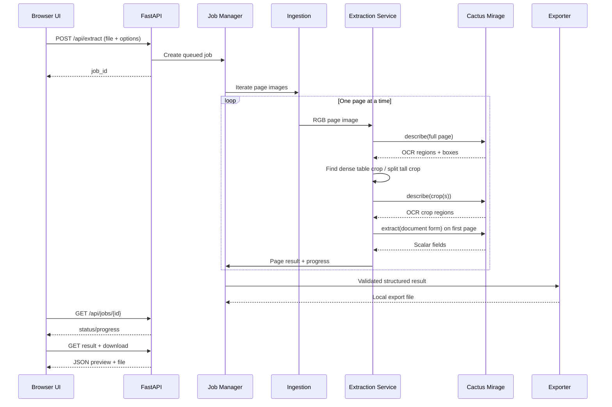

# Architecture Notes

## Component boundaries

### API layer
Accepts one upload, validates the declared format and signature, creates a local job, and exposes status/result/download endpoints. It does not know Mirage's output format.

### Ingestion layer
PDF rendering is iterator-based: a page image is yielded and consumed before the next page is rendered. Image ingestion corrects EXIF orientation and converts to RGB.

### Preprocessing layer
The image normalizer makes conservative changes. OCR region parsing translates Mirage's 0–1000 boxes into a common representation. The layout helper groups text boxes into rows, finds repeated multi-column regions, crops them, and splits tall crops with a small overlap.

### Inference layer
`VisionEngine` is the portability seam. `CactusMirageEngine` is the native Python adapter; a future WASM implementation can satisfy the same `describe` and `extract` contract. Cactus calls are protected by a lock because the SDK documents serialized inference calls across threads.

### Extraction layer
Document types are declarative `ExtractionSchema` instances. Each provides keyword hints, a Mirage form for scalar fields, a table name and table-header hints. Dynamic table rows are reconstructed from OCR geometry rather than claimed as a native arbitrary-array form.

### Validation/export layer
Pydantic validates the outer contract. JSON is lossless for the app's result structure. CSV exports the primary flat table. XLSX separates summary fields, table data and page processing information.

## Sequence

## WebAssembly migration strategy

Keep these contracts independent of FastAPI and Pillow:

- `VisionEngine.describe(image) -> structured observation`
- `VisionEngine.extract(image, form) -> structured form result`
- `TextRegion(text, bbox, score)`
- `DocumentResult` JSON shape

A browser port will need a WASM engine adapter, browser-native image decoding/canvas cropping, and a browser storage/export strategy. It will not be a drop-in replacement for Python modules; the inference and document domain contracts are the portability targets.
